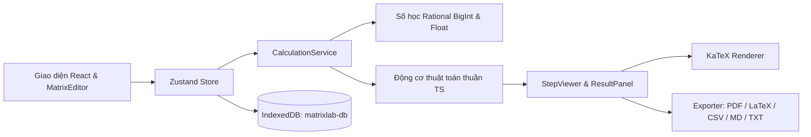

# MatrixLab — Không gian tính toán Đại số tuyến tính

**MatrixLab** là nền tảng tính toán toán học chuyên sâu về **phép toán ma trận, phân tích đặc trưng ma trận, giải hệ phương trình tuyến tính và đại số tuyến tính**, được thiết kế phục vụ sinh viên đại học, giảng viên toán học và kỹ sư cần công cụ minh bạch, chính xác và có lời giải từng bước.

> **Tuyên bố nguyên tắc cốt lõi:** MatrixLab là ứng dụng tính toán Đại số tuyến tính dựa trên các thuật toán toán học xác định. Hệ thống **không sử dụng AI, LLM hoặc API AI** để thực hiện các phép tính, sinh lời giải hay kiểm chứng kết quả.

---

## 1. Mục tiêu và Triết lý kỹ thuật

1. **Tính đúng đắn toán học:** Mọi kết quả và ma trận trung gian đều được sinh ra từ thuật toán xác định thực sự, có thể tái lập và kiểm chứng bằng các đồng nhất thức toán học (như $AA^{-1} = I$, $PA = LU$, $A = QR$, $Av = \lambda v$).
2. **Không phụ thuộc AI và chạy cục bộ 100%:** Toàn bộ động cơ toán học chạy trực tiếp trên trình duyệt người dùng, hoạt động ngoại tuyến sau khi tải trang, không gửi ma trận lên bất kỳ máy chủ hay mô hình ngôn ngữ nào.
3. **Số học phân số chính xác kết hợp dấu phẩy động minh bạch:** Hỗ trợ số học hữu tỉ chính xác bằng `BigInt` (rút gọn qua ước chung lớn nhất GCD) cho các phép toán hữu tỉ, đồng thời phân biệt rõ ràng khi nào kết quả là *giá trị chính xác* và khi nào là *xấp xỉ số học*.
4. **Ngôn ngữ giao diện 100% tiếng Việt chuẩn học thuật.**

---

## 2. Tính năng hiện có và trạng thái triển khai

| Nhóm chức năng | Tính năng cụ thể | Trạng thái | Ghi chú kỹ thuật |
|---|---|---|---|
| **Trình soạn thảo ma trận** | Tạo/sửa nhiều ma trận đặt tên (`A`, `B`, `C`...), chỉnh kích thước đến $10 \times 10$, điều hướng bàn phím (`Tab`, `Enter`, mũi tên), chế độ nhập văn bản và dán dữ liệu từ Excel/CSV | Hoàn thành | Hỗ trợ số nguyên, thập phân, ký hiệu khoa học và phân số `p/q` |
| **Phép toán ma trận cơ bản** | Cộng ($A+B$), Trừ ($A-B$), Nhân ($AB$), Nhân vô hướng ($kA$), Lũy thừa ($A^n$, cả $n \le 0$), So sánh ($A=B$) | Hoàn thành | Chính xác `BigInt` hoặc dấu phẩy động |
| **Đặc trưng ma trận** | Định thức ($\det A$ theo Laplace / Gauss / LU), Hạng ($\operatorname{rank} A$), Vết ($\operatorname{tr} A$), Tính khả nghịch, Phân loại ma trận | Hoàn thành | Bao gồm kiểm tra xác định dương qua Cholesky / Sylvester |
| **Biến đổi ma trận** | Chuyển vị ($A^T$), Nghịch đảo ($A^{-1}$ qua Gauss-Jordan $[A\mid I]$), Phụ hợp ($\operatorname{adj} A$), Dạng bậc thang (REF), RREF | Hoàn thành | Có kiểm chứng sai số dư |
| **Hệ phương trình tuyến tính** | Giải $AX = B$ (Khử Gauss, Gauss-Jordan, Cramer, Nghịch đảo), Biện luận nghiệm theo Kronecker–Capelli, Dạng tham số khi vô số nghiệm | Hoàn thành | Tự động phát hiện hàng mâu thuẫn khi vô nghiệm |
| **Trị riêng & Vectơ riêng** | Đa thức đặc trưng (Faddeev–LeVerrier), Trị riêng (Hessenberg + QR dịch chuyển Wilkinson), Không gian riêng $(A-\lambda I)v=0$ | Hoàn thành | Hỗ trợ trị riêng phức cho ma trận thực; kết quả $n \ge 3$ là xấp xỉ số học |
| **Không gian vectơ** | Không gian nghiệm $\mathcal{N}(A)$, Không gian hàng $\mathcal{R}(A)$ & cột $\mathcal{C}(A)$, Độc lập/phụ thuộc tuyến tính, Cơ sở & số chiều | Hoàn thành | Chỉ ra tổ hợp phụ thuộc khi phụ thuộc tuyến tính |
| **Phân tích ma trận** | Phân tích $PA = LU$ (Doolittle), Phân tích $A = QR$ (Modified Gram-Schmidt), Phân tích Cholesky ($A = LL^T$), Chéo hóa ($A = PDP^{-1}$) | Hoàn thành | Có kiểm chứng tái tạo trực tiếp |
| **Phân tích giá trị kỳ dị (SVD)** | Chưa triển khai trong phiên bản hiện tại | Chưa hỗ trợ | Không hiển thị nút giả trong giao diện |
| **Lưu trữ & Xuất dữ liệu** | Lịch sử cục bộ IndexedDB (mở lại, đổi tên, nhân bản, xóa), Xuất PDF, LaTeX (`.tex`), CSV, Markdown, Văn bản thuần | Hoàn thành | Xuất PDF vẽ trực tiếp trên Canvas 2D hỗ trợ đầy đủ dấu tiếng Việt |

---

## 3. Công nghệ sử dụng

Danh sách thực tế các thư viện trong `package.json`:

- **React 19 & TypeScript:** Xây dựng giao diện mô-đun và kiểm tra kiểu tĩnh chặt chẽ.
- **Vite 8 & Tailwind CSS v4:** Hệ thống đóng gói nhanh và hệ thống giao diện sáng/tối nhất quán.
- **Zustand:** Quản lý trạng thái không gian làm việc ma trận, cài đặt và kết quả tính toán.
- **KaTeX:** Hiển thị công thức toán học, ma trận và phân số với font cục bộ đóng gói sẵn.
- **idb:** Giao tiếp IndexedDB để lưu lịch sử tính toán, ma trận đã đặt tên và cài đặt người dùng.
- **jsPDF:** Kết xuất tài liệu báo cáo toán học định dạng `.pdf`.
- **Lucide React:** Biểu tượng giao diện tối giản cho các thao tác chức năng.
- **Vitest:** Bộ kiểm thử tự động cho thuật toán và các đồng nhất thức đại số tuyến tính.

---

## 4. Kiến trúc hệ thống



Xem chi tiết kiến trúc tại [`docs/ARCHITECTURE.md`](./docs/ARCHITECTURE.md), cơ sở toán học tại [`docs/MATHEMATICAL_FOUNDATIONS.md`](./docs/MATHEMATICAL_FOUNDATIONS.md) và đặc tả toàn bộ thuật toán tại [`docs/ALGORITHMS.md`](./docs/ALGORITHMS.md).

---

## 5. Hướng dẫn cài đặt và vận hành

Yêu cầu môi trường: **Node.js >= 20** và **npm**.

```bash
# 1. Cài đặt các gói phụ thuộc
npm install

# 2. Chạy môi trường phát triển (cổng 3000)
npm run dev

# 3. Kiểm tra kiểu TypeScript (lint)
npm run lint

# 4. Chạy bộ kiểm thử toán học (Vitest)
npm test

# 5. Đóng gói bản sản xuất (production build)
npm run build

# 6. Xem trước bản đóng gói sản xuất
npm run preview
```

---

## 6. Cấu trúc thư mục

```text
src/
  algorithms/          # Động cơ toán học thuần TypeScript (không phụ thuộc React)
    arithmetic/        # rational.ts (BigInt), scalar.ts, matrixOps.ts
    elimination/       # echelon.ts (Khử Gauss REF & Gauss-Jordan RREF)
    determinant/       # determinant.ts (Laplace, Gauss, LU)
    inverse/           # inverse.ts (Nghịch đảo Gauss-Jordan, Ma trận phụ hợp)
    matrix/            # properties.ts (Chuyển vị, Vết, Hạng, Khả nghịch, Phân loại)
    linear-systems/    # linearSystems.ts (Gauss, Gauss-Jordan, Cramer, A^-1 B)
    eigenvalues/       # eigen.ts (Faddeev-LeVerrier, Hessenberg-QR, Chéo hóa)
    decomposition/     # decompositions.ts (LU, QR, Cholesky)
    vector-spaces/     # vectorSpaces.ts (Null/Row/Col space, Độc lập tuyến tính)
  components/          # Thành phần giao diện tái sử dụng (MatrixEditor, StepViewer, ResultPanel...)
  pages/               # Các trang ứng dụng (HomePage, WorkspacePage, HistoryPage, SettingsPage)
  services/            # calculationService.ts, historyDb.ts (IndexedDB), exporter.ts
  store/               # useMatrixLabStore.ts
  locales/             # vi.ts (Từ điển tiếng Việt chuẩn hóa)
  types/               # math.ts
  tests/               # Bộ kiểm thử Vitest (rational, operations-and-identities, linear-systems-and-advanced)
docs/
  ALGORITHMS.md
  MATHEMATICAL_FOUNDATIONS.md
  ARCHITECTURE.md
```

---

## 7. Kiểm thử

Chạy toàn bộ kiểm thử bằng `npm test`:

- `src/tests/rational.test.ts`: Kiểm thử chuẩn hóa phân số, GCD `BigInt`, phép tính phân số, lũy thừa và phân tích chuỗi đầu vào.
- `src/tests/operations-and-identities.test.ts`: Kiểm thử phép toán cơ bản, $\det(AB)=\det(A)\det(B)$, sự nhất quán Laplace/Gauss/LU, $AA^{-1}=I$, $(A^T)^T=A$, $\operatorname{rank}(A)=\operatorname{rank}(A^T)$, $A\cdot\operatorname{adj}(A)=\det(A)I$, phân loại ma trận và xử lý lỗi đầu vào.
- `src/tests/linear-systems-and-advanced.test.ts`: Kiểm thử hệ phương trình (duy nhất, vô số nghiệm, vô nghiệm), không gian nghiệm/hàng/cột, phân tích LU/QR/Cholesky, trị riêng/vectơ riêng thực & phức và chéo hóa ma trận.

---

## 8. Giới hạn hiện tại

1. **Kích thước lưới tương tác:** Giới hạn $10 \times 10$ trong trình soạn thảo để đảm bảo hiệu năng giao diện và khả năng đọc từng bước biến đổi trên màn hình.
2. **Khai triển Laplace:** Giới hạn cấp $n \le 6$ do độ phức tạp $O(n!)$; với $n > 6$, hệ thống tự động chuyển sang khử Gauss $O(n^3)$ và thông báo rõ cho người dùng.
3. **Trị riêng và Chéo hóa:** Với $n \ge 3$, nghiệm đa thức đặc trưng được tính xấp xỉ bằng thuật toán Hessenberg + QR dịch chuyển Wilkinson; chưa giải vectơ riêng phức trên trường $\mathbb{C}^n$ khi gặp cặp trị riêng phức.
4. **Chưa hỗ trợ phần tử chứa biến ký hiệu (symbolic variables)** như $x, a, m$ trong ô ma trận, và chưa hỗ trợ SVD.

---

## 9. Đóng góp và mở rộng

Khi bổ sung thuật toán mới vào MatrixLab:
1. Triển khai hàm thuần TypeScript trong `src/algorithms/...` và trả về cấu trúc `CalculationReport` kèm bước thực thi thực tế.
2. Đăng ký vào `executeCalculation` trong `src/services/calculation-service/calculationService.ts`.
3. Viết kiểm thử đơn vị và kiểm chứng đồng nhất thức trong `src/tests/`.
4. Cập nhật tài liệu tại `docs/ALGORITHMS.md` và bảng truy vết triển khai.
